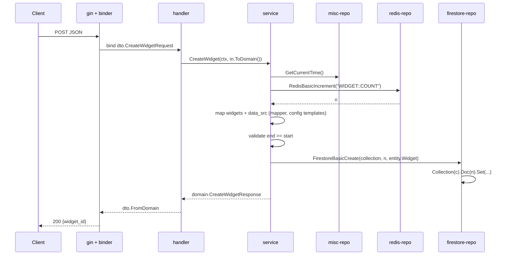
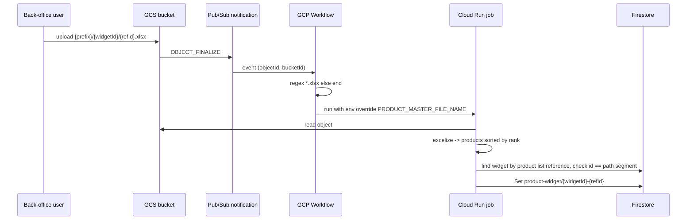

# 00 — Design rationale

This file is the full breakdown: how the reference shape is organized, how its parts
connect, how a request flows, and which choices the scaffold keeps or changes.

---

## 1. What the reference shape is

A Go **monorepo** (`go.work`) for a back-office feature. It has three deployables and one shared library:

| Component | Path | Deploys as | Trigger |
|---|---|---|---|
| HTTP API | `api/` | Cloud Run **service** | HTTP |
| Product-master upload job | `job/product-master-upload/` | Cloud Run **job** | GCS upload of `*.xlsx` → Pub/Sub → GCP Workflow → job run |
| Image-zip extraction job | `job/image-zip-extract/` | Cloud Run **job** | GCS upload of `*.zip` → Pub/Sub → GCP Workflow → job run |
| Shared library | `shared/` | library (`replace => ../shared`) | — |

```
go.work                       # use ./api ./job/* ./shared
service-name-mapper.yaml      # folder -> Cloud Run service name
Makefile                      # mockery per module, go mod tidy
.github/workflows/            # build+deploy on push to develop/sit, tag on release, UAT on tag
gcp-workflows/<job>/          # workflow.yaml + configs/<env>.yaml: event -> run Cloud Run job
api/
  cmd/server/main.go          # logger, server.Run(), exit 1 on error
  cmd/docs/main.go            # swag generation entry
  configs/{local.env,dev,sit,uat,prod}.json   # env vars per environment
  docs/                       # generated swagger
  settings/                   # envconfig -> process-global config accessor
  internal/
    server/server.go          # composition root
    router/router.go          # gin routes -> handler methods
    handler/                  # one file per endpoint + handler.go (interface + New)
      dto/                    # request/response DTOs + ToDomain/FromDomain
    core/
      domain/                 # use-case request/response structs
      port/                   # service, repository and adapter interfaces
      service/                # one file per use case + _test.go, init.go (New)
      mocks/                  # mockery output for ports
    repositories/
      firestore/              # generic basic CRUD + typed queries + Transactional
      redis/                  # INCR counter + key builder
      misc/                   # uuid + time.Now
    adapter/init.go           # external-call adapter (empty today)
    mapper/                   # widget type -> data_src URL template
job/<name>/                   # same skeleton: cmd, settings, internal/{server,core,repository}
shared/
  constant/                   # date formats, error codes, success messages
  entity/                     # storage documents (storage + json tags)
  infrastructure/             # client constructors: firebase, auth, storage, pubsub, redis, postgres, secret manager
  model/v1/                   # public API contract (request/response shapes)
  util/                       # date helpers
```

External dependencies: a private internal library supplies logging, tracing (OTel → Cloud Trace),
the gin server bootstrap, the generic request binder, the base server properties, and the Redis template.

---

## 2. Layers and how they connect


| Layer | Owns | Depends on |
|---|---|---|
| `router` | URL → handler method, swagger mount | `handler`, `config` |
| `handler` | DTO ↔ domain mapping, swag annotations | `port.Service`, `dto` |
| `handler/dto` | wire shapes shared with the public API contract | `domain`, `shared/model` |
| `core/service` | use-case orchestration, business rules | `port.*`, `domain`, shared records, `config`, `mapper` |
| `core/domain` | use-case I/O structs, entity → domain mapping | shared records |
| `core/port` | interfaces | `domain` |
| `repositories/*` | driver calls, tracing spans | driver SDKs, `domain`, shared records, `config` |
| `server` | builds every concrete object | everything |

Request lifecycle, `POST /v1/widget`:



Reads (`GET /widget`, `GET /widget/:id`) go `handler → service → firestore-repo`. The repo maps
shared records → `domain`, then the service computes `NEW / ACTIVE / INACTIVE` from `now`.
Delete reads the widget, deletes `widget/{id}`, then deletes `product-widget/{id}-{productListRefId}`.
The upload job writes that second document.

Job lifecycle (product-master upload):



---

## 3. Patterns the scaffold KEEPS

| Pattern | Scaffold location |
|---|---|
| Hexagonal core: `domain`, `port`, `service` under `internal/core` | `internal/core` |
| Service depends on interfaces only; concrete types built in one composition root | `internal/server/server.go`, one constructor per layer: `repository.New`, `service.New`, `handler.New` |
| Typed handler signature `func(ctx, Req) (*Resp, error)` + generic binder | `internal/httpx/bind.go` (`Handle[Req,Resp]`) |
| One file per use case in `service/` and `handler/` | `widget_<verb>.go` |
| Three model types: DTO / domain / record, mapped explicitly | `handler/dto`, `core/domain`, repo-local record |
| Time and IDs behind ports, so tests control them | `port.Clock`, `port.IDGenerator` |
| Transaction carried in `ctx` | `port.Transactor` |
| Fake ports for service tests | `service/fixture_test.go` (`newFixture`), one test file per use case |
| Config per environment as JSON env files; secrets from Secret Manager | `configs/` |
| Monorepo with `go.work`, jobs as separate modules, shared module for infra clients | [09-jobs-and-monorepo.md](09-jobs-and-monorepo.md) |
| Redis `INCR` for widget IDs | `repository/redis/counter.go` |

## 4. Patterns the scaffold CHANGES, and why

| # | Typical behaviour | Problem | Scaffold rule |
|---|---|---|---|
| 1 | The service imports a Redis key constant from a repository package | core depends on a repository package; swapping Redis touches the service | Port speaks intent: `IDGenerator.NextWidgetID(ctx)`. The key is private to `repository/redis`. |
| 2 | Layers read a process-global config accessor | hidden inputs; tests must set env + reload; collection names leak into business code | `config.Load()` once in `server.Run`, then each layer constructor gets its section, typed by its consumer (`service.Config`, `repository.Config`). |
| 3 | A generic create helper takes a collection name and `interface{}` | the service chooses storage layout; `interface{}` loses type safety | Repo methods per aggregate: `WidgetRepository.Create(ctx, domain.Widget)`. |
| 4 | The domain imports storage records and owns their mapping | domain changes when storage changes | Domain imports stdlib only (checked by the import command in [11-review-checklist.md](11-review-checklist.md#boundaries)). Repos map record ↔ domain. |
| 5 | The status rule is copied into both read paths and is off by one at the boundary | duplicate rule with a boundary gap | `Widget.StatusAt(now)` is the single owner, with boundary tests. |
| 6 | The Redis `INCR` runs **before** date validation | rejected requests burn IDs | Use-case order: validate → preconditions → allocate → build → persist → emit. |
| 7 | Update uses reflection plus an `excludeFields` map to protect creation fields | protection is by convention and silent on typos | Read-modify-write in a tx. `Widget.Revise` keeps `ID`/`Created*` by construction. |
| 8 | Errors are logged at every layer and returned raw; not-found is detected by matching an error string | duplicate logs; status codes can't be derived | Repos translate driver errors to `domain.ErrNotFound`/`ErrConflict`/…. Every layer wraps with `%w`. `httpx.WriteError` logs once and maps to HTTP. |
| 9 | The handler is an interface with a single implementation | indirection with no second implementation | Concrete `*handler.Handler`, one file per endpoint. Interfaces live where a second implementation exists (ports). |
| 10 | An empty `adapter` package sits beside `repositories` | unclear split | Every outbound call is a repository in `internal/repository/<store>`: Postgres, Redis, the catalog API and the broker. `repository.New` wires all of them. |
| 11 | List counts read every document on every page | reads every document on every page | Postgres runs `count(*)`. The Firestore recipe uses an aggregation count query ([08-datasources.md](08-datasources.md)). |
| 12 | Delete removes two documents without a tx | partial delete on failure | Multi-write use cases go through `Transactor`. |
| 13 | A job port returns an SDK-specific reader type | the port depends on the GCS SDK | Ports return `io.ReadCloser`. |
| 14 | A tracing helper discards the child context | spans never nest; the trace is flat | `ctx, span := tracer.Start(ctx, ...)`. |
| 15 | Infrastructure constructors log and kill the process | constructors can't fail softly, so tests can't recover | Constructors return `(T, error)`. Only `main` exits. |

## 5. Pitfalls the scaffold avoids

Worth knowing because each is easy to reintroduce.

1. **A router typo references a handler method that doesn't exist**, so the API does not compile.
2. **A job path split doesn't return after logging an error**, so indexing a missing segment panics.
3. **A sheet converter reads the first row before checking the sheet is non-empty**, so an empty sheet panics.
4. **A config initializer ignores the secret-manager client it builds**, so the client is created and never used.
5. **A repository keeps pagination helpers that nothing calls**, so they are dead code in the wrong store.
6. **Update doesn't check `end_date >= start_date`**, unlike create.
