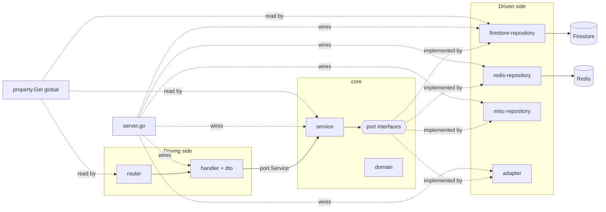
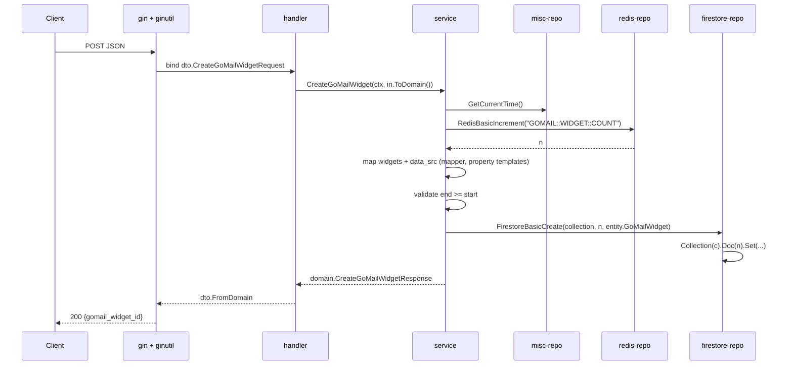
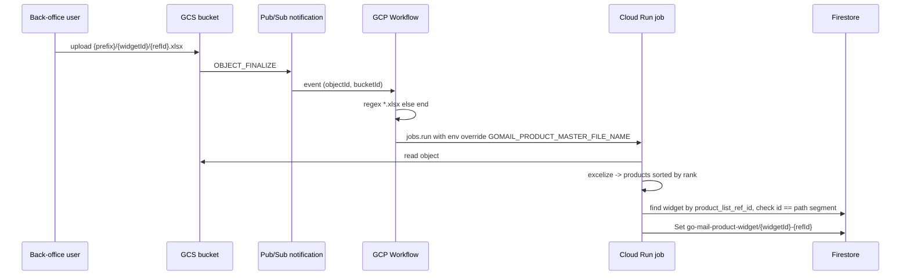

# 00 — Source analysis: `cfw-app-gomail-service`

This scaffold is derived from `cfw-app-gomail-service` (branch `develop`, commit `43495ce`).
This file is the full breakdown of that repo: what each part is, how the parts connect,
how a request flows, and which choices the scaffold keeps or changes.

---

## 1. What the repo is

A Go **monorepo** (`go.work`) for the "Go Mail" back-office feature. It has three deployables and one shared library:

| Module | Path | Deploys as | Trigger |
|---|---|---|---|
| `cfw-app-gomail-service` | `api/` | Cloud Run **service** `go-mail-api` | HTTP |
| `gomail-upload-product-master` | `job/gomail-upload-product-master/` | Cloud Run **job** | GCS upload of `*.xlsx` → Pub/Sub → GCP Workflow → job run |
| `gomail-extract-image-zip-file` | `job/gomail-extract-image-zip-file/` | Cloud Run **job** | GCS upload of `*.zip` → Pub/Sub → GCP Workflow → job run |
| `cfw-app-gomail-service-shared` | `shared/` | library (`replace => ../shared`) | — |

```
go.work                       # use ./api ./job/* ./shared
service-name-mapper.yaml      # folder -> Cloud Run service name (api: go-mail-api)
Makefile                      # mockery per module, go mod tidy
.github/workflows/            # build+deploy on push to develop/sit, tag on release, UAT on tag
gcp-workflows/<job>/          # workflow.yaml + configs/<env>.yaml: event -> run Cloud Run job
api/
  cmd/server/main.go          # logger, server.Run(), exit 1 on error
  cmd/docs/main.go            # swag generation entry
  configs/{local.env,dev,sit,uat,prod}.json   # env vars per environment
  docs/                       # generated swagger
  property/                   # envconfig -> package-global cfg, property.Get()
  internal/
    server/server.go          # composition root
    router/router.go          # gin routes -> handler methods
    handler/                  # one file per endpoint + handler.go (interface + New)
      dto/                    # request/response DTOs + ToDomain/FromDomain
    core/
      domain/                 # use-case request/response structs
      port/                   # Service, FirestoreRepository, RedisRepository, MiscRepository, Adapter
      service/                # one file per use case + _test.go, init.go (New)
      mocks/                  # mockery output for ports
    repositories/
      firestore-repository/   # generic basic CRUD + typed queries + Transactional
      redis-repository/       # INCR counter + key-builder.go
      misc-repository/        # uuid + time.Now
    adapter/init.go           # external-call adapter (empty today)
    mapper/banner-datasrc.go  # widget type -> data_src URL template
job/<name>/                   # same skeleton: cmd, property, internal/{server,core,repository}
shared/
  constant/                   # date formats, error codes, success messages
  entity/                     # Firestore documents (firestore + json tags)
  infrastructure/             # client constructors: firebase, auth, firestore, GCS, pubsub, redis, postgres, secret manager
  model/v1/                   # public API contract (request/response shapes)
  util/                       # date helpers
```

External dependencies: `centraldigital/cfw-core-lib` (private) supplies logging, tracing (OTel → Cloud Trace),
the gin server bootstrap (`setup-server`), the generic binder (`ginutil.BindReqJson200Resp`),
the base server properties, and the Redis template.

---

## 2. Layers and how they connect



| Layer | Owns | Depends on |
|---|---|---|
| `router` | URL → handler method, swagger mount | `handler.Handler`, `property` |
| `handler` | DTO ↔ domain mapping, swag annotations | `port.Service`, `dto` |
| `handler/dto` | wire shapes (aliases of `shared/model/v1`) | `domain`, `shared/model/v1` |
| `core/service` | use-case orchestration, business rules | `port.*`, `domain`, `shared/entity`, `property`, `mapper`, **`redisrepository`** |
| `core/domain` | use-case I/O structs, entity → domain mapping | **`shared/entity`** |
| `core/port` | interfaces | `domain` |
| `repositories/*` | driver calls, tracing spans | driver SDKs, `domain`, `shared/entity`, `property` |
| `server` | builds every concrete object | everything |

Request lifecycle, `POST /go-mail-api/v1/go-mail/widget`:



Reads (`GET /widget`, `GET /widget/:id`) go `handler → service → firestore-repo`. The repo maps
`shared/entity` → `domain`, then the service computes `NEW / ACTIVE / INACTIVE` from `now`.
Delete reads the widget, deletes `go-mail-widget/{id}`, then deletes `go-mail-product-widget/{id}-{productListRefId}`.
The upload job writes that second document.

Job lifecycle (upload product master):



---

## 3. Patterns the scaffold KEEPS

| Pattern | Where in source | Scaffold location |
|---|---|---|
| Hexagonal core: `domain`, `port`, `service` under `internal/core` | `api/internal/core` | `internal/core` |
| Service depends on interfaces only; concrete types built in one composition root | `server.go` | `internal/server/server.go`, one constructor per layer: `repository.New`, `service.New`, `handler.New` |
| Typed handler signature `func(ctx, Req) (*Resp, error)` + generic binder | `ginutil.BindReqJson200Resp` | `internal/httpx/bind.go` (`Handle[Req,Resp]`) |
| One file per use case in `service/` and `handler/` | `go-mail-widget-*.go` | `widget_<verb>.go` |
| Three model types: DTO / domain / entity, mapped explicitly | `dto`, `domain`, `shared/entity` | `handler/dto`, `core/domain`, repo-local record |
| Time and IDs behind ports, so tests control them | `misc-repository` | `port.Clock`, `port.IDGenerator` |
| Transaction carried in `ctx` | `Transactional` + `TxnObjKey` | `port.Transactor` |
| Fake ports for service tests (`newTestingModule`) | `service/init_test.go` | `service/fixture_test.go` (`newFixture`), one test file per use case |
| Config per environment as JSON env files; secrets from Secret Manager | `configs/*.json` | `configs/` |
| Monorepo with `go.work`, jobs as separate modules, shared module for infra clients | root | [09-jobs-and-monorepo.md](09-jobs-and-monorepo.md) |
| Redis `INCR` for widget IDs | `redis-repository` | `repository/redis/counter.go` |

## 4. Patterns the scaffold CHANGES, and why

| # | Source behaviour | Problem | Scaffold rule |
|---|---|---|---|
| 1 | `service` imports `redisrepository.GoMailWidgetCountKey` | core depends on a repository package; swapping Redis touches the service | Port speaks intent: `IDGenerator.NextWidgetID(ctx)`. The key is private to `repository/redis`. |
| 2 | `service` and repos read `property.Get()` (global) | hidden inputs; tests must set env + reload; collection names leak into business code | `config.Load()` once in `server.Run`, then each layer constructor gets its section, typed by its consumer (`service.Config`, `repository.Config`). |
| 3 | `FirestoreBasicCreate(ctx, collectionName, docId, interface{})` | service chooses storage layout; `interface{}` loses type safety | Repo methods per aggregate: `WidgetRepository.Create(ctx, domain.Widget)`. |
| 4 | `domain` imports `shared/entity`; mapping lives on domain types | domain changes when storage changes | Domain imports stdlib only (checked by the import command in [11-review-checklist.md](11-review-checklist.md#boundaries)). Repos map record ↔ domain. |
| 5 | Status rule copied into `get-by-id` and `get-list`; `now == StartDate` yields `""` | duplicate rule with a boundary gap | `Widget.StatusAt(now)` is the single owner, with boundary tests. |
| 6 | Redis INCR runs **before** date validation | rejected requests burn IDs | Use-case order: validate → preconditions → allocate → build → persist → emit. |
| 7 | Update uses reflection plus an `excludeFields` map to protect `created_*` | protection is by convention and silent on typos | Read-modify-write in a tx. `Widget.Revise` keeps `ID`/`Created*` by construction. |
| 8 | Errors logged at every layer, then returned raw; not-found detected by `strings.Contains(err, "NotFound ")` | duplicate logs; status codes can't be derived | Repos translate driver errors to `domain.ErrNotFound`/`ErrConflict`/…. Every layer wraps with `%w`. `httpx.WriteError` logs once and maps to HTTP. |
| 9 | `Handler` is an interface with a single implementation | indirection with no second implementation | Concrete `*handler.Handler`, one file per endpoint. Interfaces live where a second implementation exists (ports). |
| 10 | `adapter` (empty) vs `repositories` | unclear split | Every outbound call is a repository in `internal/repository/<store>`: Postgres, Redis, the catalog API and the broker. `repository.New` wires all of them. |
| 11 | List counts via `query.Documents(ctx).GetAll()` | reads every document on every page | Postgres runs `count(*)`. The Firestore recipe uses an aggregation count query ([08-datasources.md](08-datasources.md)). |
| 12 | Delete removes two documents without a tx | partial delete on failure | Multi-write use cases go through `Transactor`. |
| 13 | Job port `StorageRepository.ReadStorageFile` returns `*storage.Reader` | the port depends on the GCS SDK | Ports return `io.ReadCloser`. |
| 14 | `_, span := tracer.StartNewSpan(ctx, ...)` throws away the child ctx | spans never nest; the trace is flat | `ctx, span := tracer.Start(ctx, ...)`. |
| 15 | `infrastructure.NewX` calls `log.Fatalf` | constructors kill the process, so tests can't recover | Constructors return `(T, error)`. Only `main` exits. |

## 5. Defects spotted during the scan (source repo)

Worth filing separately. None of these were changed here.

1. **Uncommitted change in `api/internal/router/router.go`**: `h.GetGFoMailWidgetList` (typo). The `Handler` interface has no such method, so the API does not compile in the current working tree.
2. `job/gomail-upload-product-master/.../gomail-upload-product-master.go`: when the path doesn't split into 3 parts, the code logs an error but doesn't return. `filePath[2]` then panics.
3. `converter.go`: `rows[0]` is read before checking that `rows` is non-empty, so an empty sheet panics.
4. `property.Init(ctx, secretCli)` ignores `secretCli`, so the Secret Manager client is created and never used.
5. `firestore-repository/pagination.go` holds SQL builder helpers that nothing calls. They're dead code in a Firestore repo.
6. `UpdateGoMailWidget` doesn't check that `end_date >= start_date`, unlike create.
