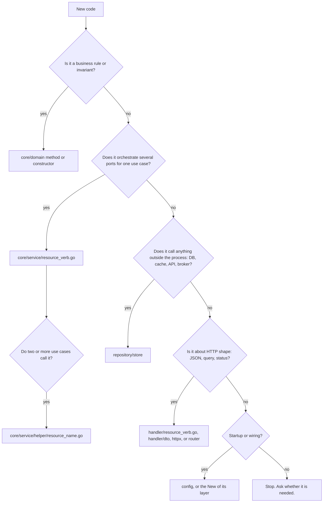

# 02 — Project structure

```
scaffold-golang/
├── AGENTS.md                         # rules for coding agents (CLAUDE.md points here)
├── README.md
├── Makefile                          # run, test, check, up, down, reset, migrate-*, ddl
├── Dockerfile                        # multi-stage, non-root, tzdata installed
├── docker-compose.yml                # postgres + redis -> migrate -> server
├── .github/workflows/check.yml       # make check, and gitleaks over the history
├── scripts/                          # check_layout.py, check_config.py (make lint-layout, lint-config)
├── go.mod
├── configs/
│   ├── local.env                     # sourced by `make run`
│   └── dev.json                      # per-env vars for the deploy pipeline (add sit/uat/prod)
├── db/
│   ├── postgres/
│   │   ├── migrations/               # source of truth: 000001_<name>.up.sql + .down.sql pairs
│   │   └── ddl/schema.sql            # derived by `make ddl`; never edited
│   └── redis/keys.md                 # the whole Redis keyspace
├── cmd/
│   ├── server/main.go                # signals + exit code only
│   └── devtoken/main.go              # local ES256 keypair + dev tokens (make dev-auth, make token)
├── docs/convention/                  # this convention set
└── internal/
    ├── config/config.go              # env -> typed Config, once
    ├── auth/auth.go                  # Verifier (ES256 bearer tokens), WithActor, ActorFrom
    ├── server/server.go              # composition root: one constructor per layer
    ├── router/router.go              # URL -> handler method table
    ├── httpx/
    │   ├── bind.go                   # Handle[Req,Resp]: bind uri+query+json, call, write
    │   ├── auth.go                   # Authenticate: bearer token -> actor in ctx, else 401
    │   ├── deadline.go               # Deadline: every request ctx ends after REQUEST_TIMEOUT
    │   └── errors.go                 # WriteError: domain kind -> HTTP status, log once
    ├── handler/
    │   ├── handler.go                # Handler{svc port.Services}, New
    │   ├── widget_create.go          # one endpoint per file: CreateWidget
    │   ├── widget_get.go             # GetWidget
    │   ├── widget_list.go            # ListWidgets
    │   ├── widget_update.go          # UpdateWidget
    │   ├── widget_delete.go          # DeleteWidget
    │   └── dto/
    │       ├── common.go             # SuccessResponse, ErrorResponse
    │       └── widget.go             # request/response shapes + ToDomain / FromDomain
    ├── core/
    │   ├── domain/
    │   │   ├── errors.go             # ErrInvalidInput, ErrNotFound, ErrConflict, ErrUnavailable
    │   │   ├── widget.go             # aggregate, input, NewWidget, Revise, StatusAt, WidgetView
    │   │   ├── page.go               # Page, PageResult[T]
    │   │   └── event.go              # WidgetEvent
    │   ├── port/
    │   │   ├── port.go               # package doc + Repositories{Repo, RedisRepo, Adpt}
    │   │   ├── service.go            # driving ports + Services (one field per resource)
    │   │   ├── database.go           # Repo = Transactor + WidgetRepository
    │   │   └── adapter.go            # RedisRepo = IDGenerator + WidgetCache + EventPublisher; Adapter = CatalogAdapter; Clock
    │   └── service/
    │       ├── service.go            # Config, Deps, New, one struct per resource
    │       ├── helper/               # one shared function per file, dependencies as arguments
    │       │   ├── widget_check_input.go       # CheckWidgetInput: validate + catalog precondition
    │       │   └── widget_resolve_data_src.go  # WidgetDataSrc, ResolveWidgetDataSrc
    │       ├── widget_create.go      # one use case per file
    │       ├── widget_get.go
    │       ├── widget_list.go
    │       ├── widget_update.go
    │       ├── widget_delete.go
    │       ├── fixture_test.go       # fixture, fakes, newFixture: shared by every test file
    │       ├── widget_fixture_test.go # validInput: shared by every widget test file
    │       └── widget_<verb>_test.go # one file, one TestWidget<Verb>, per use case
    ├── repository/                   # every outbound call: database, cache, API, broker
    │   ├── repository.go             # Config, New: picks one implementation per port
    │   ├── memory/                   # in-process stand-ins (local runs + test fakes)
    │   │   ├── widget.go             # Repo: record, mapping, widget methods
    │   │   ├── tx.go                 # Repo.WithinTx
    │   │   ├── redis_repo.go         # RedisRepo, NewRedisRepo
    │   │   ├── counter.go            # RedisRepo.NextWidgetID
    │   │   ├── cache.go              # RedisRepo cache methods
    │   │   └── publisher.go          # RedisRepo.PublishWidgetEvent, to the log
    │   ├── postgres/                 # pgx v5
    │   │   ├── postgres.go           # Config, Open, mapErr, querier
    │   │   ├── tx.go                 # Repo.WithinTx, joinOrBeginTx, txFrom, conn
    │   │   └── widget.go             # SQL, row mapping, Repo widget methods
    │   ├── redis/                    # go-redis v9
    │   │   ├── redis.go              # Config, Open, key names, mapErr
    │   │   ├── counter.go            # Repo.NextWidgetID (INCR)
    │   │   ├── cache.go              # Repo cache methods (GET/SET with TTL) + JSON record
    │   │   └── publisher.go          # Repo.PublishWidgetEvent (XADD to a stream)
    │   └── catalog/http.go           # Client implements Adapter over HTTP (+ AllowAll)
    └── platform/clock.go             # SystemClock
```

## Naming

| Kind | Rule | Example |
|---|---|---|
| Package dirs | lower case, no dashes, no `_` | `repository/postgres` |
| Files | `snake_case`. `<resource>_<verb>.go` for a use case or an endpoint | `widget_create.go` |
| Shared helper | `service/helper/<resource>_<name>.go`, one exported function per file, named `<Verb><Resource><Noun>` | `widget_check_input.go` holds `CheckWidgetInput` |
| Tests | service layer only, `package service_test`, one `Test<Resource><Verb>` per file | `widget_create_test.go` |
| Driving port | `<Resource>Service`, collected in `port.Services` | `WidgetService` |
| Driven port | one field per datasource: `Repo` (database.go), `RedisRepo` and `Adapter` (adapter.go). Each embeds one interface per resource or system, with resource-named methods. | `s.repo.CreateWidget`, `s.redisRepo.GetCachedWidget`, `s.adpt.ProductListExists` |
| Layer constructor | one `New` per layer, covering every resource | `repository.New`, `service.New`, `handler.New` |
| Handler method | `<Verb><Resource>` on `*handler.Handler` | `CreateWidget` |
| Storage struct | `<resource>Record`, unexported, in the repository package | `widgetRecord` |
| DTOs | `<Verb><Resource>Request/Response` | `CreateWidgetRequest` |
| Migrations | `NNNNNN_<verb>_<object>.up.sql` and `.down.sql` | `000002_create_widget_components.up.sql` |
| URL params | kebab case | `/:widget-id` |
| JSON fields | snake case | `header_name_th` |

## Where does new code go?



There is no `utils`, `common` or `misc` package. A helper lives in the package that uses it.
Inside that package, a function one file calls stays in that file.
When a second file calls it, move it to its own file in `service/helper`. Pass its dependencies as arguments, such as `CheckWidgetInput(ctx, s.adpt, in)`.
A helper that performs I/O is not a service helper. Put it behind a port and implement it in `repository/<store>`.
