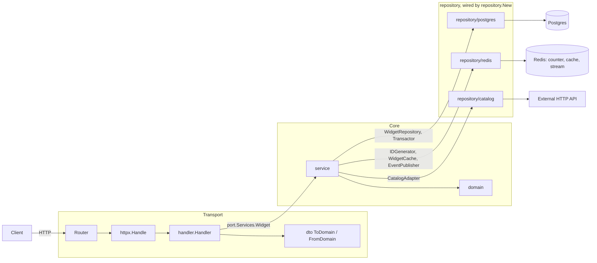
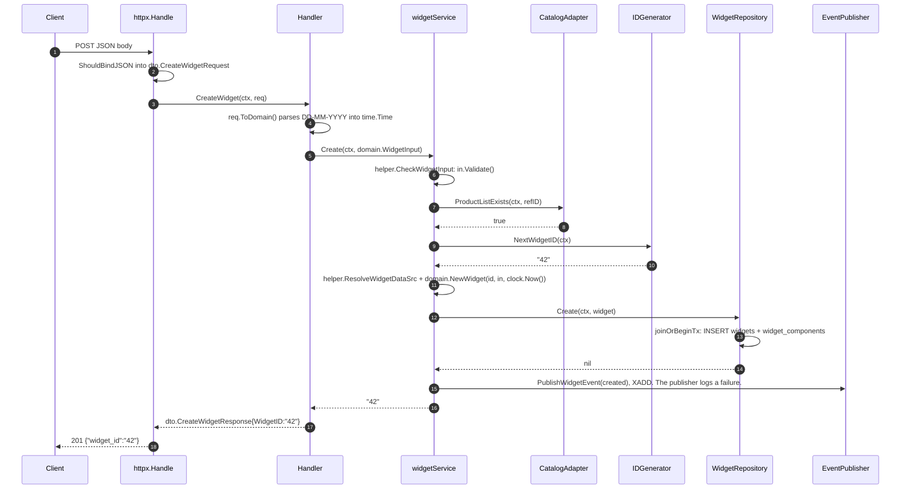
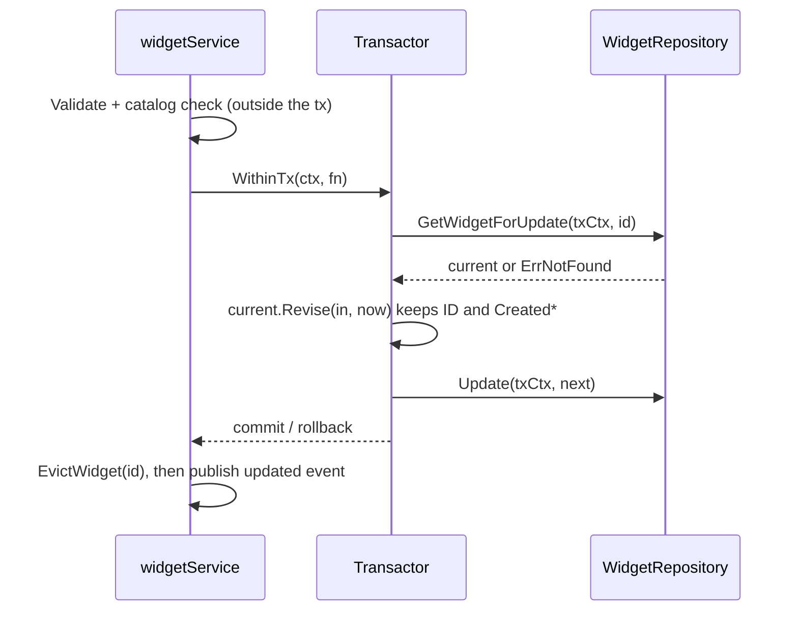
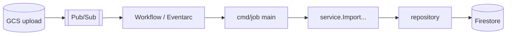

# 04 — Request and data flow

## The shape



Data changes shape twice on the way in and twice on the way out:

```
JSON ──dto.ToDomain──▶ domain.WidgetInput ──domain.NewWidget──▶ domain.Widget ──SQL args──▶ widgets + widget_components rows
JSON ◀─dto.FromDomain─ domain.WidgetView  ◀──service adds Status── domain.Widget ◀──scanWidget── rows, or toDomain from the Redis widgetRecord
```

---

## Trace: `POST /scaffold-api/v1/widgets`



| Step | File | What can fail | Becomes |
|---|---|---|---|
| 2 | `httpx/bind.go` | malformed JSON | `ErrInvalidInput` → 400 |
| 4 | `handler/dto/widget.go` | bad date format | `ErrInvalidInput` → 400 |
| 6 | `core/domain/widget.go` | missing field, reversed dates, unknown type | `ErrInvalidInput` → 400 |
| 7 | `repository/catalog/http.go` | timeout, 5xx | `ErrUnavailable` → 503 |
| 7 | service | ref ID does not exist | `ErrInvalidInput` → 400 |
| 9 | `repository/redis/counter.go` | Redis down | `ErrUnavailable` → 503 |
| 12 | `repository/postgres/widget.go` | duplicate ID (`23505`) | `ErrConflict` → 409 |
| 12 | `repository/postgres/postgres.go` | Postgres down or restarting | `ErrUnavailable` → 503 |

---

## Trace: `PUT /scaffold-api/v1/widgets/:widget-id` (read-modify-write)



Keep external calls **out** of the transaction. Inside it, `GetWidgetForUpdate` runs `SELECT ... FOR UPDATE`, so a concurrent update waits.
The cache entry is evicted after the commit. A read between the two sees the old entry, and no read can store it after the eviction.

---

## Trace: `GET /scaffold-api/v1/widgets/:widget-id` (cache-aside)

1. `GetCachedWidget(ctx, id)`. A hit skips Postgres.
2. On a miss, `repo.GetWidget(ctx, id)` reads Postgres, and `CacheWidget` stores it for `WIDGET_CACHE_TTL`.
3. The service derives `Status` from `Clock.Now()` on every read, so a cached entry never holds a stale status.
4. With Redis down, every read is a miss. The API still answers, and the server logs `widget cache get failed`.

---

## Trace: `GET /scaffold-api/v1/widgets?page_id=2&page_size=10`

1. `httpx` binds the query into `dto.ListWidgetsRequest` (`form:` tags).
2. `req.ToDomain()` → `domain.Page{Number: 2, Size: 10}`.
3. The service calls `page.Normalize()`, so defaults and the max size live in one place.
4. `repo.List(ctx, page)` → `([]domain.Widget, total, error)`. The repo does the ordering and offset/limit natively.
5. The service builds `WidgetView{Status: w.StatusAt(now)}` for each item.
6. `dto.ListWidgetsFromDomain` adds the running `no`, formats dates and computes `last_page`.

---

## Trace: a job or message consumer

A job is a second driving adapter. It calls the **same** `port.Services` a handler would:



See [09-jobs-and-monorepo.md](09-jobs-and-monorepo.md).

---

## Cross-cutting concerns: where each one lives

| Concern | Where | How |
|---|---|---|
| Request context and cancellation | `httpx.Handle` passes `c.Request.Context()` | every port method takes `ctx` first |
| Tracing | middleware in `server.go` (otelgin) + a span per repository method | [08-datasources.md](08-datasources.md#recipe-tracing) |
| Logging | `slog` default set in `server.go`; errors logged in `httpx.WriteError`, best-effort failures in their repository | context-aware `slog.*Context` |
| Auth | `httpx.Authenticate(auth.Verifier)` on the `/v1` group in `router.go` verifies the ES256 bearer token and puts its `email` claim in ctx | the handler copies `auth.ActorFrom(ctx)` into `WidgetInput.Actor`, so the service never reads auth from ctx and no client sets the actor |
| Validation | shape in `dto.ToDomain`, rules in `domain.Validate` | — |
| Time zone | `API_TIME_ZONE` → `handler.Config.WireZone` → `dto` parse and format | domain and storage use `time.Time` |
