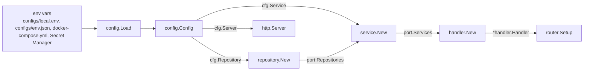

# 06 — Config and wiring

## Flow



- `server.Run` calls `config.Load()` once.
- Each section has the type that its consumer defines: `service.Config`, `repository.Config`, `postgres.Config`, `redis.Config` and `catalog.Config`.
  Those packages never import `internal/config`, so `server.Run` hands each section over without copying fields.
- After startup, nothing reads env vars or holds package-level config.

## Keys

| Key | Section field | Default | Empty means |
|---|---|---|---|
| `SERVICE_NAME`, `HOST`, `PORT`, `SHUTDOWN_TIMEOUT`, `LOG_JSON`, `GIN_MODE` | `Server.*` | see `config.go` | — |
| `WIDGET_PRODUCT_DATA_SRC` (`%s` widget ID, then sub type), `WIDGET_CATEGORY_DATA_SRC` (`%s` widget ID) | `Service.Widget.DataSrc.ProductDataSrc`, `.CategoryDataSrc` | the origin templates | rejected unless the `%s` count matches |
| `WIDGET_PROMOTION_TYPE` | `Service.Widget.DataSrc.InformationSubType` | `PROMOTION` | — |
| `AUTH_JWT_PUBLIC_KEY_FILE` | `Auth.PublicKeyFile` | none | required: a path to the ES256 public key PEM, mounted from Secret Manager |
| `AUTH_JWT_ISSUER`, `AUTH_JWT_AUDIENCE` | `Auth.Issuer`, `.Audience` | none | required |
| `REQUEST_TIMEOUT` | `Server.RequestTimeout`, and `Repository.EvictHold` = 2 × it | `10s` | rejected unless positive |
| `API_TIME_ZONE` | `Handler.WireZone` | `Asia/Bangkok` | rejected unless `time.LoadLocation` knows it |
| `POSTGRES_DSN` (secret) | `Repository.Postgres.DSN` | `""` | memory widgets and transactor |
| `POSTGRES_MAX_CONNS` | `Repository.Postgres.MaxConns` | `10` | — |
| `REDIS_ADDR` | `Repository.Redis.Addr` | `""` | memory counter, cache and log publisher |
| `REDIS_PASSWORD` (secret), `REDIS_DB` | `Repository.Redis.Password`, `.DB` | `""`, `0` | — |
| `WIDGET_CACHE_TTL` | `Repository.Redis.CacheTTL` | `5m` | rejected unless positive |
| `CATALOG_BASE_URL` | `Repository.Catalog.BaseURL` | `""` | `catalog.AllowAll` |
| `CATALOG_API_KEY` (secret), `CATALOG_TIMEOUT` | `Repository.Catalog.APIKey`, `.Timeout` | `""`, `3s` | — |

Durations take Go syntax (`30s`) or bare seconds (`30`), through `env.durOrSeconds`.
`POSTGRES_DSN` needs `REDIS_ADDR`, and `WIDGET_CACHE_TTL` must be positive. `repository.New` refuses to start otherwise.

## Sources by environment

| Env | How the vars arrive |
|---|---|
| local, memory | `make run` sources `configs/local.env` |
| local, containers | `make up` sets them in `docker-compose.yml` under `server.environment` |
| dev, sit, uat, prod | the deploy pipeline sets Cloud Run env from `configs/<env>.json` |
| secrets | Secret Manager mounted as env, such as `--set-secrets POSTGRES_DSN=widget-db-dsn:latest` |

Never put a secret in `configs/*`. `.gitignore` excludes `*.secret` and service-account JSON files.
The credentials in `docker-compose.yml` exist only for the local stack.

## Wiring in `server.Run`

1. `config.Load()`, then the logger.
2. `auth.New(cfg.Auth)` reads the public key, so a missing key stops startup.
3. `repository.New(ctx, cfg.Repository, log)` opens and pings every configured client and returns `port.Repositories` and `close`. Call `defer close()`.
4. `service.New(cfg.Service, service.Deps{Repositories: repos, Clock: platform.SystemClock{}})` returns `port.Services`.
5. `handler.New(svcs, cfg.Handler)`, then `router.Setup(engine, h, verifier)`, then `serve(ctx, ...)`.

A failed `Open` returns its error up to `main`, so a bad DSN or address stops the process at startup.
Only `main` calls `os.Exit`. Constructors return `(T, error)`.

## Swapping implementations

`repository.New` is the one function that names concrete repository types.
It starts from the memory stand-ins, then replaces the ports that each configured client backs:

```go
if cfg.Postgres.DSN != "" {
	pool, err := postgres.Open(ctx, cfg.Postgres)
	if err != nil {
		close()
		return port.Repositories{}, nil, err
	}
	closers = append(closers, pool.Close)
	r.Repo = postgres.New(pool)
}
```

`port.Repo` holds the widget methods and `WithinTx` together, so a repository and its transaction always come from one client.
To add a backend, add a section to `repository.Config` and one block here. `server.go` stays the same.
