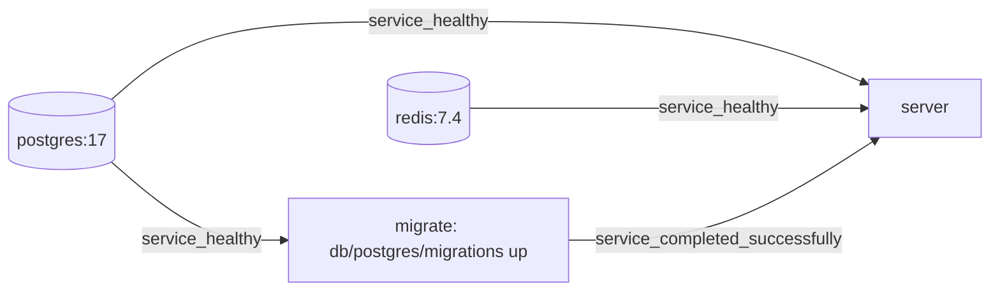

# 08 — Datasources: Postgres, Redis, external APIs, and recipes for others

Every outbound call lives in `internal/repository/<store>`. `repository.New` picks one store per port.
This file has two parts.

- **Compiled stores.** `postgres`, `redis`, `catalog` and `memory` are built and tested by `make up`.
- **Recipes.** Firestore, Pub/Sub, GCS and tracing are not compiled in this repo. They target `cloud.google.com/go/firestore`,
  `cloud.google.com/go/pubsub` (the v1 API) and `cloud.google.com/go/storage`. Run `go get` for the one you add.

Every store has the same parts: `Config` and `Open`, the storage shape and its mapping, `mapErr`, and a transaction from ctx when the store has transactions.

---

## Local stack — `docker-compose.yml`



| Command | Does |
|---|---|
| `make up` | builds the image, starts Postgres and Redis, applies the migrations, then starts the API on `localhost:8080` |
| `make down` | stops the stack and keeps the data |
| `make reset` | stops the stack and drops both volumes. Drop them together, because the ID counter lives in Redis. |
| `make migrate-up`, `make migrate-down N=1`, `make migrate-down-all` | applies, rolls back N, or rolls back every migration |
| `make migrate-new NAME=add_widget_tags` | creates the next numbered `.up.sql` and `.down.sql` |
| `make ddl` | regenerates `db/postgres/ddl/schema.sql` from the migrated database |
| `make ddl-check` | regenerates it and fails when it differs from the committed file. The `schema` CI job runs it after migrations up, fully down, and up again. |

`make run` needs no Docker, because empty `POSTGRES_DSN` and `REDIS_ADDR` select the memory stores.
To run the binary on the host against the containers, set the two values in `configs/local.env` comments.

---

## Postgres — `internal/repository/postgres` (pgx v5)

**Schema.** `db/postgres/migrations` owns it. Each change is a numbered pair that `golang-migrate` applies in order:

```
db/postgres/migrations/
  000001_create_widgets.up.sql             CREATE TABLE widgets ... CHECK (end_date >= start_date)
  000001_create_widgets.down.sql           DROP TABLE widgets
  000002_create_widget_components.up.sql   CREATE TABLE widget_components ... ON DELETE CASCADE
  000002_create_widget_components.down.sql DROP TABLE widget_components
db/postgres/ddl/schema.sql                 pg_dump --schema-only of the result (make ddl)
```

`schema.sql` is derived, so it cannot drift. Read it to see the current schema, and read its diff in review.
Write the migrations by hand. The server never runs DDL. The `migrate` service in `docker-compose.yml` runs it, and so does the deploy pipeline before a rollout.

**Files.**

| File | Holds |
|---|---|
| `postgres.go` | `Config{DSN, MaxConns}`, `Repo` and `New(pool)`. `Open` parses the DSN, builds the `pgxpool.Pool` and pings it. `mapErr` and `querier`. |
| `tx.go` | `Repo.WithinTx`. `joinOrBeginTx` joins the `pgx.Tx` in ctx or begins one. `txFrom` and `conn(ctx, pool)`. |
| `widget.go` | the SQL constants, `scanWidget`, `insertComponents`, `attachComponents`, and the `Repo` widget methods |

**Transactions ride in ctx.** `Repo.WithinTx` puts the `pgx.Tx` in ctx. Every repository method calls `conn(ctx, pool)`, so it joins that transaction:

```go
func joinOrBeginTx(ctx context.Context, pool *pgxpool.Pool, fn func(ctx context.Context) error) error {
	if _, ok := txFrom(ctx); ok {
		return fn(ctx) // already inside one: join it
	}
	tx, err := pool.Begin(ctx)
	if err != nil {
		return mapErr(err)
	}
	defer func() { _ = tx.Rollback(context.WithoutCancel(ctx)) }() // no-op after Commit
	if err := fn(context.WithValue(ctx, txKey{}, tx)); err != nil {
		return err // already a domain kind: do not map it again
	}
	return mapErr(tx.Commit(ctx))
}
```

`Create` and `Update` also call `joinOrBeginTx`. The widget row and its components then commit together, whether or not the service opened a transaction.
`Update` reads with `GetWidgetForUpdate`, which adds `FOR UPDATE`, so its read-modify-write cannot lose a concurrent update. Plain `Get` takes no lock. `GetWidgetForUpdate` outside `WithinTx` returns an error in both `postgres` and `memory`, so a use case that passes the outer ctx fails its service test.

**Errors by SQLSTATE**, never by message text:

| Code or class | Meaning | Kind |
|---|---|---|
| `*pgconn.ConnectError`, a `net.Error`, or a timeout | the server never answered | `ErrUnavailable` |
| any other error, such as a scan error or a cancelled ctx | a bug, or the client left | returned as is, 500 |
| class `08`, `53`, `57` | connection, resources, shutdown (`57P01`) | `ErrUnavailable` |
| `23505` | `unique_violation` | `ErrConflict` |
| `23514`, `23502`, `22001` | check, not null, value too long | `ErrInvalidInput` |
| `pgx.ErrNoRows`, or 0 rows affected | the row is missing | `ErrNotFound`, in the method |

The `57` class matters. When Postgres restarts, the pool's open connections fail with `57P01 admin_shutdown`. Without the class rule, the API answered 500 instead of 503.

---

## Redis — `internal/repository/redis` (go-redis v9)

`db/redis/keys.md` lists every key. The names are constants in `redis.go`, and no other package knows them.

| Port | File | Command | On failure |
|---|---|---|---|
| `IDGenerator` | `counter.go` | `INCR scaffold:widget-id` | `ErrUnavailable`. Create answers 503. |
| `WidgetCache` | `cache.go` | `GET`, `SET ... NX EX` to fill, `SET ... evicted PX <EvictHold>` to evict, on `scaffold:widget-cache:<id>` | logged, treated as a miss |
| `EventPublisher` | `publisher.go` | `XADD scaffold:widget-events MAXLEN ~ 10000` | logged |

**The cache is a port, not a decorator.** `widget_get.go` does cache-aside, and `widget_update.go` and `widget_delete.go` invalidate after the commit:

```go
w, ok := s.redisRepo.GetCachedWidget(ctx, id)
if !ok {
	if w, err = s.repo.GetWidget(ctx, id); err != nil {
		return domain.WidgetView{}, fmt.Errorf("get widget %s: %w", id, err)
	}
	s.redisRepo.CacheWidget(ctx, w)
}
```

A decorator around `port.Repo` would hide the cache from the service tests. It would also serve the `Get` inside the update transaction from the cache, which skips the `FOR UPDATE` lock.
The cache stores `domain.Widget` without status, so `StatusAt` stays correct for a cached entry.
`EvictWidget` writes the `evicted` marker for `EvictHold` instead of deleting the key. `CacheWidget` fills only an absent key, with `SET NX`. A read that fetched the old widget before the update committed cannot overwrite the marker, so it cannot store the old widget. `TestWidgetGet` reproduces that race with `racingRepo`. A failed eviction leaves the old entry for at most `WIDGET_CACHE_TTL`.

**Events.** Each `XADD` entry has the fields `type`, `widget_id`, `actor` and `at` (RFC 3339, UTC). A consumer reads the stream with a consumer group:

```bash
docker compose exec redis redis-cli XGROUP CREATE scaffold:widget-events audit 0
docker compose exec redis redis-cli XREADGROUP GROUP audit worker-1 COUNT 10 STREAMS scaffold:widget-events '>'
```

The use cases pass `context.WithoutCancel(ctx)` to `EvictWidget` and `PublishWidgetEvent` after the commit, so a client disconnect cannot skip them.

**Pairing rules**, checked at startup:
- `POSTGRES_DSN` without `REDIS_ADDR` fails. The memory counter would restart at 1 and collide with stored rows.
- `WIDGET_CACHE_TTL` must be positive. Redis treats 0 as no expiry.

**Hold window, derived.** `httpx.Deadline` ends every request's ctx after `REQUEST_TIMEOUT`, and `CacheWidget` skips the fill once ctx has ended. A read that can race an update started before the eviction, so it sends its fill before the eviction time plus `REQUEST_TIMEOUT`. `EvictHold` is twice `REQUEST_TIMEOUT`, so the marker outlives every such fill, including one still in flight. After an update, reads go to Postgres for that hold. `TestWidgetGet` covers the race, the end of the hold and the ended ctx.

---

## Recipe: Firestore repository — `internal/repository/firestore`

```go
package firestore

import (
	"context"
	"errors"
	"fmt"
	"time"

	"cloud.google.com/go/firestore"
	"cloud.google.com/go/firestore/apiv1/firestorepb"
	"google.golang.org/api/iterator"
	"google.golang.org/grpc/codes"
	"google.golang.org/grpc/status"

	"github.com/kritpi/scaffold-golang/internal/core/domain"
	"github.com/kritpi/scaffold-golang/internal/core/port"
)

type Config struct {
	WidgetCollection string // e.g. "go-mail-widget"
}

type Repo struct {
	cli *firestore.Client
	cfg Config
}

var _ port.Repo = (*Repo)(nil)

func New(cli *firestore.Client, cfg Config) *Repo {
	return &Repo{cli: cli, cfg: cfg}
}

// ----- record: the only place firestore tags exist -----

type widgetRecord struct {
	HeaderTH         string            `firestore:"header_name_th"`
	HeaderEN         string            `firestore:"header_name_en"`
	SubHeaderTH      string            `firestore:"sub_header_name_th"`
	SubHeaderEN      string            `firestore:"sub_header_name_en"`
	StartDate        time.Time         `firestore:"start_date"`
	EndDate          time.Time         `firestore:"end_date"`
	ProductListRefID string            `firestore:"product_list_ref_id"`
	Components       []componentRecord `firestore:"widgets"`
	CreatedAt        time.Time         `firestore:"created_datetime"`
	CreatedBy        string            `firestore:"created_by"`
	UpdatedAt        time.Time         `firestore:"updated_datetime"`
	UpdatedBy        string            `firestore:"updated_by"`
}

type componentRecord struct {
	Type     string `firestore:"type"`
	SubType  string `firestore:"sub_type,omitempty"`
	ImageURL string `firestore:"image_url,omitempty"`
	DataSrc  string `firestore:"data_src,omitempty"`
	IsActive bool   `firestore:"is_active"`
}

func toRecord(w domain.Widget) widgetRecord           { /* field by field */ }
func (r widgetRecord) toDomain(id string) domain.Widget { /* field by field; ID = doc ID */ }

func (r *Repo) doc(id string) *firestore.DocumentRef {
	return r.cli.Collection(r.cfg.WidgetCollection).Doc(id)
}

// ----- methods -----

func (r *Repo) CreateWidget(ctx context.Context, w domain.Widget) error {
	var err error
	if tx := txFrom(ctx); tx != nil {
		err = tx.Create(r.doc(w.ID), toRecord(w))
	} else {
		_, err = r.doc(w.ID).Create(ctx, toRecord(w)) // Create fails with AlreadyExists, unlike Set
	}
	return mapErr(err, w.ID)
}

func (r *Repo) GetWidget(ctx context.Context, id string) (domain.Widget, error) {
	var (
		snap *firestore.DocumentSnapshot
		err  error
	)
	if tx := txFrom(ctx); tx != nil {
		snap, err = tx.Get(r.doc(id))
	} else {
		snap, err = r.doc(id).Get(ctx)
	}
	if err != nil {
		return domain.Widget{}, mapErr(err, id)
	}
	var rec widgetRecord
	if err := snap.DataTo(&rec); err != nil {
		return domain.Widget{}, fmt.Errorf("decode widget %s: %w", id, err)
	}
	return rec.toDomain(snap.Ref.ID), nil
}

// Update replaces the document. The service calls it inside WithinTx after a
// Get, so the read happens before the write (a Firestore tx requirement).
func (r *Repo) UpdateWidget(ctx context.Context, w domain.Widget) error {
	return r.inTx(ctx, func(tx *firestore.Transaction) error {
		if _, err := tx.Get(r.doc(w.ID)); err != nil {
			return mapErr(err, w.ID)
		}
		return tx.Set(r.doc(w.ID), toRecord(w))
	})
}

func (r *Repo) DeleteWidget(ctx context.Context, id string) error {
	if tx := txFrom(ctx); tx != nil {
		return mapErr(tx.Delete(r.doc(id), firestore.Exists), id)
	}
	_, err := r.doc(id).Delete(ctx, firestore.Exists) // NotFound if missing
	return mapErr(err, id)
}

func (r *Repo) ListWidgets(ctx context.Context, p domain.Page) ([]domain.Widget, int, error) {
	col := r.cli.Collection(r.cfg.WidgetCollection)

	// Count with an aggregation query: one billed read per 1000 index entries,
	// not one per document (the source repo used GetAll()).
	agg, err := col.NewAggregationQuery().WithCount("total").Get(ctx)
	if err != nil {
		return nil, 0, mapErr(err, "")
	}
	total := int(agg["total"].(*firestorepb.Value).GetIntegerValue())

	it := col.OrderBy("updated_datetime", firestore.Desc).
		Offset(p.Offset()).Limit(p.Size).Documents(ctx)
	defer it.Stop()

	var out []domain.Widget
	for {
		snap, err := it.Next()
		if errors.Is(err, iterator.Done) {
			break
		}
		if err != nil {
			return nil, 0, mapErr(err, "")
		}
		var rec widgetRecord
		if err := snap.DataTo(&rec); err != nil {
			return nil, 0, fmt.Errorf("decode widget %s: %w", snap.Ref.ID, err)
		}
		out = append(out, rec.toDomain(snap.Ref.ID))
	}
	return out, total, nil
}
```

Offset reads are still billed per skipped document. For large collections, switch the port to
cursor paging (`Page{After string}`) and use `StartAfter`.

`GetWidgetForUpdate` is `GetWidget` read through `tx.Get` when `txFrom(ctx)` is set. It returns an error otherwise. Firestore locks every document a transaction reads.

**Transactions** (`tx.go`):

```go
type txKey struct{}

func (r *Repo) WithinTx(ctx context.Context, fn func(ctx context.Context) error) error {
	if txFrom(ctx) != nil {
		return fn(ctx) // already inside one: join it
	}
	// Firestore may retry fn on contention, so fn must be idempotent and must not call external systems.
	return r.cli.RunTransaction(ctx, func(ctx context.Context, tx *firestore.Transaction) error {
		return fn(context.WithValue(ctx, txKey{}, tx))
	})
}

func txFrom(ctx context.Context) *firestore.Transaction {
	tx, _ := ctx.Value(txKey{}).(*firestore.Transaction)
	return tx
}

func (r *Repo) inTx(ctx context.Context, fn func(*firestore.Transaction) error) error {
	if tx := txFrom(ctx); tx != nil {
		return fn(tx)
	}
	return r.cli.RunTransaction(ctx, func(_ context.Context, tx *firestore.Transaction) error { return fn(tx) })
}
```

**Error translation** (`errors.go`):

```go
func mapErr(err error, id string) error {
	if err == nil {
		return nil
	}
	switch status.Code(err) {
	case codes.NotFound:
		return fmt.Errorf("%w: widget %s", domain.ErrNotFound, id)
	case codes.AlreadyExists:
		return fmt.Errorf("%w: widget %s", domain.ErrConflict, id)
	case codes.Unavailable, codes.DeadlineExceeded, codes.ResourceExhausted:
		return fmt.Errorf("%w: firestore: %v", domain.ErrUnavailable, err)
	default:
		return fmt.Errorf("firestore widget %s: %w", id, err)
	}
}
```

**Wiring**, a branch in `repository.New`. Import the package as `fsrepo`, because the SDK package is also named `firestore`:

```go
if cfg.Firestore.ProjectID != "" {
	fs, err := firestore.NewClient(ctx, cfg.Firestore.ProjectID)
	if err != nil {
		close()
		return port.Repositories{}, nil, err
	}
	closers = append(closers, func() { _ = fs.Close() })
	r.Repo = fsrepo.New(fs, fsrepo.Config{WidgetCollection: cfg.Firestore.WidgetCollection})
}
```

---

## External HTTP API — `internal/repository/<system>`

The reference is [`internal/repository/catalog/http.go`](../../internal/repository/catalog/http.go). Rules:

- Its `Config` holds the base URL, API key (from a secret) and timeout. The timeout must be shorter than the inbound request deadline.
- Build every request with `http.NewRequestWithContext(ctx, ...)`.
- Always close **and drain** the body so connections are reused.
- Map 404 to `false` or `ErrNotFound`, 4xx to `ErrInvalidInput` only when the caller's input caused it,
  and 5xx, timeouts and transport errors to `ErrUnavailable`.
- Retry only idempotent calls, inside the repository:

```go
for attempt := 0; ; attempt++ {
	ok, err := c.once(ctx, refID)
	if err == nil || !errors.Is(err, domain.ErrUnavailable) || attempt == 2 {
		return ok, err
	}
	select {
	case <-time.After(time.Duration(100<<attempt) * time.Millisecond):
	case <-ctx.Done():
		return false, ctx.Err()
	}
}
```

---

## Recipe: Pub/Sub publisher — `internal/repository/pubsub`

```go
type Publisher struct {
	topic *pubsub.Topic
	log   *slog.Logger
}

var _ port.EventPublisher = (*Publisher)(nil)

func NewPublisher(cli *pubsub.Client, topicID string, log *slog.Logger) *Publisher {
	return &Publisher{topic: cli.Topic(topicID), log: log}
}

// Wire format is owned here, not in the domain.
type widgetEventMessage struct {
	Type     string    `json:"type"`
	WidgetID string    `json:"widget_id"`
	Actor    string    `json:"actor,omitempty"`
	At       time.Time `json:"at"`
}

func (p *Publisher) PublishWidgetEvent(ctx context.Context, e domain.WidgetEvent) {
	body, err := json.Marshal(widgetEventMessage{Type: string(e.Type), WidgetID: e.WidgetID, Actor: e.Actor, At: e.At})
	if err == nil {
		res := p.topic.Publish(context.WithoutCancel(ctx), &pubsub.Message{
			Data:       body,
			Attributes: map[string]string{"event_type": string(e.Type)},
		})
		_, err = res.Get(ctx)
	}
	if err != nil {
		p.log.WarnContext(ctx, "publish widget event failed", "type", e.Type, "widget_id", e.WidgetID, "err", err)
	}
}

func (p *Publisher) Stop() { p.topic.Stop() } // append to closers in repository.New to flush
```

`port.RedisRepo` bundles three ports, so Pub/Sub replaces only the events part. Compose the field in `repository.New`:

```go
rr := redis.New(rdb, cfg.Redis.CacheTTL, log)
pub := pubsub.NewPublisher(psClient, cfg.PubSub.TopicID, log)
r.RedisRepo = struct {
	port.IDGenerator
	port.WidgetCache
	port.EventPublisher
}{rr, rr, pub}
```

(The `pubsub/v2` module renames `Topic` to `Publisher` (`client.Publisher(topicID)`). The repository shape stays the same.)

### Delivery guarantee: outbox

The reference publishes after the write, and the publisher only logs failures. That's fine when a lost event is acceptable.
When consumers **must** see every change:

1. Add `port.Outbox.Add(ctx, domain.WidgetEvent)` and call it inside the same `WithinTx` as the write.
   The repository writes it to an `outbox` table or collection.
2. A relay (`cmd/outbox-relay`, or a Firestore trigger) reads pending rows, publishes them, and marks them sent.
3. Consumers dedupe on an event ID.

---

## Recipe: object storage (GCS) — `internal/repository/gcs`

Ports return `io.ReadCloser`, never `*storage.Reader`. The source repo's job ports leaked that SDK type.

```go
type Bucket struct {
	cli *storage.Client
	cfg Config // Bucket string
}

func (b *Bucket) Open(ctx context.Context, object string) (io.ReadCloser, error) {
	r, err := b.cli.Bucket(b.cfg.Bucket).Object(object).NewReader(ctx)
	if errors.Is(err, storage.ErrObjectNotExist) {
		return nil, fmt.Errorf("%w: object %s", domain.ErrNotFound, object)
	}
	return r, err
}

func (b *Bucket) Write(ctx context.Context, object string, src io.Reader) error {
	ctx, cancel := context.WithCancel(ctx)
	defer cancel()
	w := b.cli.Bucket(b.cfg.Bucket).Object(object).NewWriter(ctx)
	if _, err := io.Copy(w, src); err != nil {
		cancel() // abort: Close alone would commit a partial object
		_ = w.Close()
		return fmt.Errorf("write %s: %w", object, err)
	}
	return w.Close() // the upload is committed here; always check this error
}
```

---

## Recipe: tracing

One span per repository method, and **use the returned ctx** so child spans nest.
The source repo wrote `_, span := tracer.StartNewSpan(ctx, ...)` and dropped the child ctx.

```go
var tracer = otel.Tracer("internal/repository/postgres")

func (r *Repo) GetWidget(ctx context.Context, id string) (w domain.Widget, err error) {
	ctx, span := tracer.Start(ctx, "Repo.GetWidget", trace.WithAttributes(attribute.String("widget.id", id)))
	defer func() {
		if err != nil {
			span.RecordError(err)
			span.SetStatus(otelcodes.Error, err.Error())
		}
		span.End()
	}()
	...
}
```

Server-side: `engine.Use(otelgin.Middleware(cfg.Server.ServiceName))` in `server.go`. HTTP repositories use
`otelhttp.NewTransport(http.DefaultTransport)` as their client transport.
