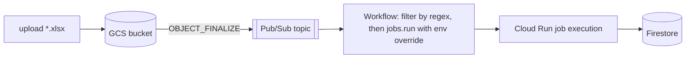

# 09 — Jobs, consumers and the monorepo layout

## When to stay single-module vs go monorepo

| Situation | Layout |
|---|---|
| One API, maybe a worker that shares its domain | **single module**, more binaries under `cmd/` (`cmd/server`, `cmd/worker`) |
| Several deployables with separate dependency sets, release cadence or owners | **`go.work` monorepo**, as in the source repo |

### Monorepo layout (source-repo style, cleaned up)

```
go.work                      # use ./api ./job/* ./shared
service-name-mapper.yaml     # folder -> Cloud Run service name (CI matrix)
api/                         # this scaffold, as-is
job/<job-name>/              # same skeleton, smaller:
  cmd/job/main.go
  configs/{local.env,dev.json,...}
  internal/{config,server,core/{domain,port,service},repository/*}
  Dockerfile
shared/                      # library module, `replace` in each go.mod
  infrastructure/            # client constructors returning (client, error)
  model/v1/                  # public request/response contract (DTOs only)
gcp-workflows/<job-name>/    # event -> job trigger
.github/workflows/           # build/deploy matrix per folder
```

What `shared/` may hold: client constructors, public API DTOs, and constants that are truly global.
What it must not hold: domain types, records/entities, business rules. Those belong to the module that owns the data.
The source repo's `shared/entity` was imported by `api` and both jobs, which ties three deployables to one storage layout.

## A job is just another driving adapter

The core shape is identical. Only `cmd` and the trigger differ:

```go
// job/import-product-master/cmd/job/main.go
func main() {
	ctx, stop := signal.NotifyContext(context.Background(), os.Interrupt, syscall.SIGTERM)
	defer stop()
	if err := server.RunJob(ctx); err != nil {
		slog.Error("job failed", "err", err) // the one log line for this failure
		os.Exit(1)                           // non-zero -> Cloud Run marks the execution failed and retries per policy
	}
}

// job/import-product-master/internal/server/server.go
func RunJob(ctx context.Context) error {
	cfg, err := config.Load() // includes per-execution overrides like SOURCE_OBJECT
	if err != nil {
		return err
	}
	repos, closeRepos, err := repository.New(ctx, cfg.Repository, slog.Default()) // the same driven layer
	if err != nil {
		return err
	}
	defer closeRepos()

	// Add Import port.ImportService to port.Services, and a Files port that repository/gcs implements.
	svcs := service.New(cfg.Service, service.Deps{Repositories: repos, Clock: platform.SystemClock{}})
	return svcs.Import.ImportProductMaster(ctx, cfg.SourceObject)
}
```

Job service rules:
- Inputs arrive as arguments (`ImportProductMaster(ctx, object)`), not by reading config inside the service.
- Parse and validate the path **before** reading the file, and return `ErrInvalidInput` when it's malformed.
  The source job logged the error and went on to index past the end of the slice.
- Parsers (xlsx, csv) are pure functions from `io.Reader` to `[]domain.X`, The use-case test feeds them a memory `Files` fake, with no GCS.
- Make jobs **idempotent**: deterministic document IDs (`{widgetID}-{refID}`) plus `Set`, so a retry overwrites instead of duplicating.

## Trigger chain (GCP)



The workflow passes the object path as an env override (`containerOverrides[].env`).
In the job, that env var is ordinary config and is read once in `config.Load()`.

## Message consumer (push or pull)

A Pub/Sub **pull** consumer is a long-running `cmd/worker`:

```go
sub := psClient.Subscription(cfg.SubscriptionID)
err := sub.Receive(ctx, func(ctx context.Context, m *pubsub.Message) {
	var msg widgetEventMessage
	if err := json.Unmarshal(m.Data, &msg); err != nil {
		slog.ErrorContext(ctx, "poison message", "id", m.ID, "err", err)
		m.Ack() // can never succeed: ack (or route to a dead-letter topic)
		return
	}
	switch err := svc.HandleWidgetChanged(ctx, msg.toDomain()); {
	case err == nil, errors.Is(err, domain.ErrNotFound), errors.Is(err, domain.ErrInvalidInput):
		m.Ack()
	default:
		m.Nack() // transient: redeliver
	}
})
```

A **push** subscription is just an HTTP endpoint. Add a route and a handler, decode the Pub/Sub
envelope in the DTO, and return 2xx to ack or 5xx to retry.

## CI/CD pattern (from the source repo)

- On push to `develop`/`sit`: a matrix over `service-name-mapper.yaml` builds and deploys each Cloud Run service,
  and a matrix over `job/*` builds and deploys each job. Env vars come from `<folder>/configs/<env>.json`.
- On push to `release`: auto-create a tag. On a new tag: build the UAT image. Prod deploys manually.
- GCP Workflows deploy from `gcp-workflows/<name>/workflow.yaml` + `configs/<env>.yaml`.

Keep this: one folder = one deployable = one Dockerfile = one config set per env.
